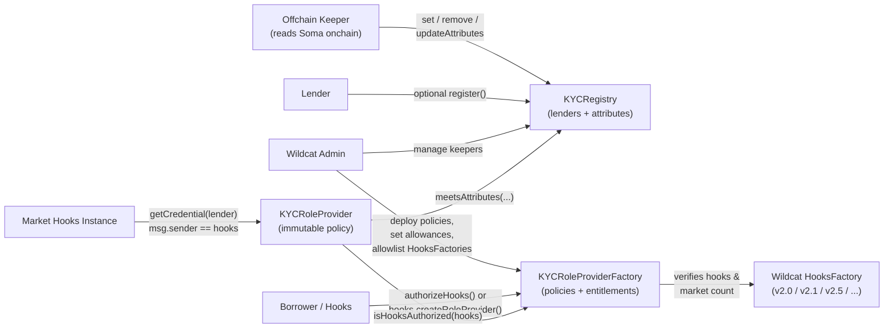

# KYCRoleProvider

Attribute-backed lender registry, immutable policy providers, and onchain
borrower market-slot entitlements for Wildcat hooks. Wallet addresses,
attributes, timestamps, and events are public onchain; keep identity records
and other PII offchain.

## Architecture



Three immutable contracts (no proxies, no oracles, no runtime upstream KYC
dependency):

1. [`KYCRegistry`](../../src/providers/KYCRegistry.sol) — singleton lender
   registry and per-attribute cache. Makes no external calls and survives future
   factory redeploys.
2. [`KYCRoleProviderFactory`](../../src/providers/KYCRoleProviderFactory.sol) —
   singleton managing canonical policies, allowlisted `HooksFactory` contracts,
   borrower market allowances, and hooks authorization.
3. [`KYCRoleProvider`](../../src/providers/KYCRoleProvider.sol) — immutable,
   ownerless, `view`-only `IRoleProvider` enforcing one attribute policy.

## `KYCRegistry`

Stores Wildcat-enrolled wallets and their cached attributes. Because the
registry makes no external calls, swapping or adding upstream KYC providers
requires no contract migration.

### Roles and keeper trust model

- **`administrator`:** two-step handoff via
  [`ManagedRoleProvider`](../../src/providers/ManagedRoleProvider.sol)
  ([`IManagedRoleProvider`](../../src/access/IManagedRoleProvider.sol)). Manages
  `isKeeper` and can prune unverified wallets.
- **`keeper`:** trusted hot key that can write and remove any attribute on any
  wallet and tag `sourceId`. There is no automatic rollback or global pause: if
  a keeper key is compromised, the administrator revokes it via
  `setKeeper(keeper, false)` and a backup keeper batch-removes invalid
  attributes.

### Storage and attributes

- Registered lenders live in an OpenZeppelin `EnumerableSet.AddressSet`,
  readable via `isRegistered`, `getRegisteredLendersCount`, and half-open
  `[start, end)` `getRegisteredLenders(start, end)`.
- Per-lender attribute keys live in `EnumerableSet.Bytes32Set`, paired with
  `mapping(address => mapping(bytes32 => KYCAttribute))`. Each `KYCAttribute`
  packs into 16 bytes of one slot:

```solidity
struct KYCAttribute {
  uint40 issuedAt;   // nonzero presence/issuance metadata; not an activation gate
  uint40 expiresAt;  // 0 = no expiry; otherwise inclusive expiry timestamp
  uint40 updatedAt;  // block.timestamp of latest keeper write
  uint8 sourceId;    // provenance tag (e.g. 1 = Wildcat, 2 = Soma, 3+ = future)
}
```

- **Registration:** lenders can opt in permissionlessly via `register()` (zero
  attributes, emits `LenderRegistered`). Keepers auto-register wallets on first
  attribute write so lenders onboarding through the Wildcat frontend pay no
  registration gas. Keepers or the administrator can clean up empty
  registrations via `pruneUnverifiedLenders(accounts)` (reverts if any wallet
  holds an attribute).
- **Atomic updates:** use `updateAttributes(sets, removals)` for multi-attribute
  transitions such as jurisdiction changes. Removals run before sets in the same
  transaction so a replaced key finishes set with no intermediate inconsistent
  block. Single and batch `setAttribute(s)` / `removeAttribute(s)` are also
  available.
- **Expiry vs. presence:**
  - `hasActiveAttribute(account, attributeId)` returns true iff `issuedAt != 0`
    and `(expiresAt == 0 || block.timestamp <= expiresAt)`. `issuedAt` is
    presence and issuance metadata, not a future-activation gate, so minor clock
    skew between offchain issuance and L1 `block.timestamp` won't block fresh
    KYC.
  - `hasAttribute(account, attributeId)` returns true iff `issuedAt != 0`,
    ignoring `expiresAt`. Negative policy checks use this so disqualifying
    attributes never expire into allowed.
  - `meetsAttributes(account, required, forbidden)` evaluates both lists inside
    one `staticcall`.

## `KYCRoleProvider` and policy design

Each `KYCRoleProvider` is immutable, ownerless, and `view`-only
(`isPullProvider == true`):

- **`requiredAttributes`:** every key must pass `hasActiveAttribute`.
- **`forbiddenAttributes`:** every key must fail `hasAttribute` (fail-closed
  until removed by a keeper).
- **`meetsPolicy(account)`:** ungated eligibility predicate for UI/SDK previews.
- **`getCredential(account)` / `validateCredential(account, data)`:** returns
  `0` if `!factory.isHooksAuthorized(msg.sender)`; otherwise returns
  `block.timestamp.toUint32()` when `meetsPolicy(account)` is true (reverting
  without wrapping past `type(uint32).max`) and `0` otherwise.

**Soma positive-flag model:** Soma emits positive indicators only
(`INSTITUTIONAL`, `ACCREDITED`, `US`), paired with Wildcat's verification marker
(`WILDCAT_SOMA_VERIFIED`). A Non-US policy is therefore
`required: [WILDCAT_SOMA_VERIFIED], forbidden: [US]`. Keepers must write
`WILDCAT_SOMA_VERIFIED` alongside every Soma flag for a wallet in one atomic
`setAttributes` or `updateAttributes` call so a US wallet never sits verified
without its `US` flag.

**OR-composition:** `BaseAccessControls` iterates attached pull providers and
accepts the first match. To allow *US Accredited OR Non-US*, attach both
canonical providers to the same hooks instance (0 extra market slots).

## `KYCRoleProviderFactory` and entitlements

### Entitlement boundary and billing

`KYCRoleProviderFactory` gates Wildcat's official canonical policies and tracks
borrower market-slot reservations onchain for offchain billing reconciliation:

- `KYCRegistry`, `meetsPolicy`, and `AttributeSet` events are public onchain; a
  custom `IRoleProvider` could always read the registry directly outside
  official Wildcat UI/SDK/subgraph support and outside the borrower's agreement.
- `usedSlots[borrower]` tracks unreclaimed market-slot reservations across
  authorized hooks, not historical deposit count.
- Detaching the last `KYCRoleProvider` from an open market leaves its slot
  charged until the market permanently closes (`isClosed()`), preventing
  slot-recycling across active markets.

### Policy catalog and allowances

- **Admin-only policy deployment:** `deployRoleProvider(name, requiredAttributes, forbiddenAttributes)`
  validates nonzero, strictly ascending, disjoint keys, deduplicates by
  `keccak256(abi.encode(requiredAttributes, forbiddenAttributes))`, and deploys
  via CREATE2.
- **`setProviderAttachmentEnabled(provider, enabled)`:** soft deprecation gate
  on `createRoleProvider` and UI discovery. Authorization stays hooks-level, so
  already-attached hooks and direct `hooks.addRoleProvider` calls on an
  authorized hook stay unaffected.
- **Forward-looking `borrowerAllowance`:** lowering `borrowerAllowance` below
  `usedSlots[borrower]` blocks new slot allocations without disabling live
  authorized hooks.
- **Allowlisted `HooksFactory` set:** `setHooksFactory(hooksFactory, allowed)`
  gates new authorizations and slot expansions (`delta > 0`); removing a factory
  never disables already-authorized hooks on it.

### Hooks authorization, rotation, and closed-market reclamation

Each authorized hooks instance stores:

```solidity
struct HooksAuthorization {
  address hooksFactory;
  address borrower;            // pinned allowance account charged & credited
  uint32 approvedMarketCount;  // ceiling vs HooksFactory.getMarketsForHooksInstanceCount
  uint32 reclaimedMarketCount; // closed markets already reclaimed on this hooks instance
}
```

- **`isHooksAuthorized(hooksInstance)`:** returns true iff
  `approvedMarketCount != 0` and
  `HooksFactory.getMarketsForHooksInstanceCount(hooksInstance) <= approvedMarketCount`.
  Because `HooksFactory.deployMarket` does not call role providers or factories,
  deploying an unapproved market onto a shared KYC hook pushes the count above
  `approvedMarketCount` and halts fresh credentials on that hook until the
  borrower expands `approvedMarketCount`.
- **`authorizeHooks` / `createRoleProvider`:**
  - `hooks.createRoleProvider(kycFactory, ttl, abi.encode(KYCRoleProviderAttachInputs))`
    authorizes `msg.sender` and returns an existing canonical policy so
    `BaseAccessControls` attaches it in one transaction without deploying a
    contract.
  - When `targetApprovedMarketCount == approvedMarketCount` (`delta == 0`),
    attaching another KYC policy spends 0 slots and succeeds even at cap.
  - On first authorization of a shared hook with pre-existing closed markets,
    pass those indices in `closedMarketsToReclaim` (while
    `slotReclamationEnabled` is true) to pay only for net open/pre-allocated
    slots.
- **`reduceUnusedSlots(hooksInstance, newApprovedMarketCount)`:** refunds unused
  pre-allocated slots down to `newApprovedMarketCount >= currentMarkets`
  (clearing the record when reduced to `0` on an empty hooks instance).
- **`reclaimClosedMarket(hooksInstance, marketIndex)` / `reclaimClosedMarkets(claims)`:**
  permissionless while `slotReclamationEnabled` is true (default `true`,
  admin-toggleable). Requires `marketIndex < approvedMarketCount` and
  `marketIndex < currentMarkets`, reads the market address from `HooksFactory`,
  calls `market.updateState()` so any v2.5 projected scheduled closure commits
  permanently before checking `market.isClosed()`, marks
  `closedMarketReclaimed[market] = true`, increments `reclaimedMarketCount`, and
  decrements `usedSlots[auth.borrower]`. `approvedMarketCount` stays unchanged
  so other open markets on that hooks instance keep running.
- **`migrateHooksBorrower(hooksInstance)`:** after a hooks-admin rotation
  changes `hooks.borrower()` from `oldBorrower` to `newBorrower`, either
  `newBorrower` or the factory administrator can rebind `auth.borrower`, moving
  only unreclaimed slots (`approvedMarketCount - reclaimedMarketCount`) from
  `oldBorrower` to `newBorrower` (checking `borrowerAllowance[newBorrower]`).

### Borrower flows

| Flow | Transactions | Notes |
| --- | --- | --- |
| Existing market, first KYC provider | 1 tx: `hooks.createRoleProvider(kycFactory, ttl, inputs)` | Pass pre-closed market indices on the same hook in `closedMarketsToReclaim` to pay only net open slots |
| Existing market, 2nd KYC provider (e.g. Reg D + Reg S) | 1 tx: `hooks.addRoleProvider(provider2, ttl)` or `createRoleProvider` | `delta == 0`; consumes 0 extra slots |
| New market via `deployMarketAndHooks` | Tx 1: `deployMarketAndHooks` with `existingProviders: [provider]`<br/>Tx 2: `kycFactory.authorizeHooks(hooksFactory, hooks, 1)` | Fail-closed until Tx 2 because the hooks constructor runs before `HooksFactory` marks `isHooksInstance` |
| Hooks-first pre-allocation | Tx 1: `deployHooksInstance`<br/>Tx 2: `hooks.createRoleProvider(...)` (`target = 1`)<br/>Tx 3: `deployMarket` | Fails fast if out of allowance; KYC is live at block 0 of the market |
| Authorized shared hook, additional market | Tx 1: `kycFactory.authorizeHooks(hooksFactory, hooks, current + 1)`<br/>Tx 2: `deployMarket` | Expand before deploying so existing markets on the shared hook never freeze |
| Post-rotation v2.5 hooks admin | Tx 1: `kycFactory.migrateHooksBorrower(hooks)` (by new hooks admin or Wildcat admin) | Unblocks future slot expansions on the rotated hooks instance |

## Hook compatibility and TTL

- **TTL is enforcement and revocation latency:** `BaseAccessControls` caches a
  lender's approval per hooks instance until `credentialTimestamp + ttl`. A
  positive TTL lets an already-cached lender keep depositing across that hooks
  instance after attribute removal, expiry, or an over-cap freeze until cache
  expiry. **Default the Wildcat frontend to `TTL = 0`** for KYC policies.
- **Known lenders:** under both v2.0/v2.1 and v2.5 hooks, a lender who is
  already a known lender on a market can still receive market tokens, queue
  withdrawals, and claim under the market's rules after attributes expire or are
  removed.
- **Sanctions:** handled independently by `WildcatSanctionsSentinel` at the
  market layer; `KYCRoleProvider` has no admin hook-revocation backdoor.

| Surface | v2.0 / v2.1 | v2.5 | Notes |
| --- | --- | --- | --- |
| `IRoleProvider` | Identical | Identical | Both call with `msg.sender == hooksInstance` |
| `HooksFactory` getters | Identical | Identical | `isHooksInstance`, `getMarketsForHooksInstanceCount`, `getMarketsForHooksInstance(hooks, start, end)` |
| `IHooks.borrower()` | Immutable borrower | Alias for `administrator` | `auth.borrower` pinned at activation; rotate via `migrateHooksBorrower` |
| `IWildcatMarket.updateState()` / `isClosed()` | Identical | Identical | Calling `updateState()` before `isClosed()` commits v2.5 scheduled closure permanently |

## Canonical build and verification

Production deployment uses **`FOUNDRY_PROFILE=ir`** (`via_ir = true`,
`optimizer = true`, `optimizer_runs = 50_000`, Solc `0.8.25`, EVM `cancun`,
`bytecode_hash = 'none'`). Unoptimized `profile.default` is for local test runs
only (`KYCRoleProviderFactory` exceeds EIP-170 without the optimizer, just like
`WildcatMarket`).

Check runtime sizes against EIP-170 (24,576 B):

```sh
FOUNDRY_PROFILE=ir forge build --sizes \
  src/providers/KYCRegistry.sol \
  src/providers/KYCRoleProvider.sol \
  src/providers/KYCRoleProviderFactory.sol
```

| Contract | Runtime size | EIP-170 margin |
| --- | ---: | ---: |
| `KYCRegistry` | 9,080 B | +15,496 B |
| `KYCRoleProvider` | 2,332 B | +22,244 B |
| `KYCRoleProviderFactory` | 21,313 B | +3,263 B |

Run the KYC suites (42 tests across 5 suites, including 3,000 fuzz runs):

```sh
FOUNDRY_PROFILE=default forge test --match-path 'test/providers/*.t.sol' --summary
FOUNDRY_PROFILE=ir forge test --match-path 'test/providers/*.t.sol' --summary
```

Run the artifact-pinned v2.5 compatibility suites against a disposable checkout
of `release/v2.5` (`27b3f79e`, with submodules initialized) to verify exact
runtime code hashes of the canonical IR build:

```sh
FOUNDRY_PROFILE=ir forge build \
  src/providers/KYCRegistry.sol \
  src/providers/KYCRoleProvider.sol \
  src/providers/KYCRoleProviderFactory.sol

cp src/providers/IKYCRegistry.sol src/providers/IKYCRoleProvider.sol \
  src/providers/IKYCRoleProviderFactory.sol "$V25_CHECKOUT/src/providers/"
cp test/providers/KYCMarketLifecycle.sol test/providers/KYCRoleProviderHooks.t.sol \
  compat/v2.5/test/providers/KYCRoleProviderMarketsV25.t.sol "$V25_CHECKOUT/test/providers/"
cp ir-out/KYCRegistry.sol/KYCRegistry.json "$V25_CHECKOUT/deployments/KYCRegistry.ir.json"
cp ir-out/KYCRoleProviderFactory.sol/KYCRoleProviderFactory.json "$V25_CHECKOUT/deployments/KYCRoleProviderFactory.ir.json"
cp ir-out/KYCRoleProvider.sol/KYCRoleProvider.json "$V25_CHECKOUT/deployments/KYCRoleProvider.ir.json"

cd "$V25_CHECKOUT"
forge build src test/mocks
KYC_V25_TEST_REGISTRY_ARTIFACT=deployments/KYCRegistry.ir.json \
KYC_V25_TEST_FACTORY_ARTIFACT=deployments/KYCRoleProviderFactory.ir.json \
KYC_V25_TEST_PROVIDER_ARTIFACT=deployments/KYCRoleProvider.ir.json \
  forge test --match-contract '^KYCRoleProvider(Hooks|MarketsV25)Test$'
```
